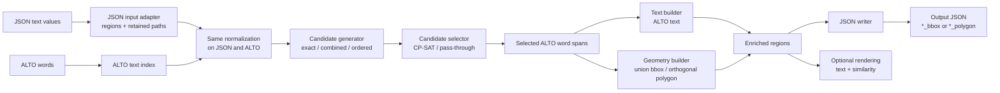
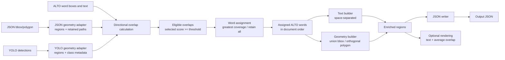

# Text geometry aligner

This package aligns structured input with word-level ALTO OCR in either
direction:

- `TextAligner` matches text from JSON and adds geometry derived from ALTO.
- `GeometryAligner` matches JSON or YOLO geometry and adds text from ALTO.

The aligner name describes the information used for matching, not the
information it produces. Both directions enrich the same document hierarchy.
Consequently, the **text alignment pipeline contains a geometry builder**,
while the **geometry alignment pipeline contains a text builder**.

It can be used from the command line with directories or from Python with
individual files, explicit file collections, or directories.

## Shared alignment model

All input adapters create the same mutable hierarchy:

```text
AlignmentDocument
└── AlignmentPage
    └── AlignmentRegion
        └── AlignmentWord
```

The hierarchy is available before and after matching. Input fields are kept
separate from ALTO-derived fields:

- `AlignmentDocument` holds `input_path`, `alto_path`, and all pages.
- `AlignmentPage` holds its input and ALTO file paths, `alto_page_id`,
  `alto_width`, `alto_height`, and its regions.
- `AlignmentRegion` holds `input_text`, `input_text_normalized`,
  `input_geometry`, the selected text-alignment candidate, `alto_text`,
  `alto_text_normalized`, `alto_geometry`, assigned `words`, JSON paths, and
  optional source-specific category metadata. Its `label` always retains the
  source name; optional `label_export` supplies a different exported name.
- `AlignmentWord` records the selected ALTO word, its normalized comparison
  text, bbox, ALTO indexes, element ID, directional coverage values, and the
  overlap score used for matching.

Fields produced by matching are `None` before matching and remain `None` when
no match is found. JSON pages additionally retain a private working copy in
`json_source_data` so their original arbitrary nesting can be reconstructed
without reading the file again. YOLO and Label Studio pages set
`json_source_data` to `None` because their output JSON is constructed from the
regions.

When an `AlignmentRegion` receives suspicious input geometry, it emits one
warning containing its region ID, source and export labels, category ID, JSON
paths, geometry, and all detected issues. Coordinates below zero, dimensions
below 5 units, areas below 100 square units, and non-finite values are
considered suspicious. Readers log the page key and source file (or in-memory
source) before creating regions, so each warning can be traced back to its
input page.

## Installation

Install the package in editable mode from this repository:

```bash
python -m pip install -e .
```

The dependency roles are:

| Dependency | Used for |
| --- | --- |
| Levenshtein | Fuzzy and ordered text alignment |
| OR-Tools | Global CP-SAT candidate selection |
| Pillow | Optional alignment rendering |
| Shapely | Polygon-to-word overlap; bbox overlap also has a dependency-free implementation |

ALTO XML and JSON are read with the Python standard library.

## The two directions

### Text alignment: text in, geometry out

`TextAligner` recursively extracts JSON scalar values, compares them with ALTO
text, chooses compatible matches, and builds geometry around the selected ALTO
words.



The geometry builder is the final step because text matching identifies ALTO
words but does not itself define how their output geometry should be
represented.

Available geometry builders:

- `UnionBoundingBoxGeometryBuilder` returns one bounding box enclosing all
  matched word boxes.
- `OrthogonalPolygonGeometryBuilder` groups matched words by ALTO line and
  creates a closed, axis-aligned polygon that closely covers the words.

For example:

```json
{
  "title": "ROKY ZA STOLETÍ",
  "publisher": [
    "ŠOLC a ŠIMÁČEK",
    "společnost s r. o. v Praze."
  ]
}
```

With bbox output, the parallel result has the same list shape:

```json
{
  "title": "ROKY ZA STOLETÍ",
  "publisher": [
    "ŠOLC a ŠIMÁČEK",
    "společnost s r. o. v Praze."
  ],
  "title_bbox": {
    "x": 108,
    "y": 442,
    "width": 1262,
    "height": 168
  },
  "publisher_bbox": [
    {
      "x": 509,
      "y": 2257,
      "width": 478,
      "height": 52
    },
    {
      "x": 504,
      "y": 2307,
      "width": 486,
      "height": 54
    }
  ]
}
```

An unmatched value receives `null` geometry. String, integer, and float values
are alignable; booleans and existing geometry keys are ignored. Nested
dictionaries and lists are retained through their JSON paths. Scalar list
values must ultimately be owned by a dictionary key so that a parallel
geometry key can be created. Each geometry key is written right after its
value key.

### Geometry alignment: geometry in, text out

`GeometryAligner` creates regions from suffixed JSON geometry or absolute
YOLO detections, measures how much of each ALTO word they cover, resolves
competing regions, and enriches the regions with ALTO text and geometry.



The text builder is the final step because geometry matching identifies the
covered ALTO words but does not define how their text should be reconstructed.
The current `SpaceSeparatedTextBuilder` joins words in ALTO document order
using one space.

For example:

```json
{
  "title_bbox": {
    "x": 108,
    "y": 442,
    "width": 1262,
    "height": 168
  },
  "publisher_bbox": [
    {
      "x": 509,
      "y": 2257,
      "width": 478,
      "height": 52
    },
    {
      "x": 504,
      "y": 2307,
      "width": 486,
      "height": 54
    }
  ]
}
```

Can produce:

```json
{
  "title": "ROKY ZA STOLETÍ",
  "title_bbox": {
    "x": 108,
    "y": 442,
    "width": 1262,
    "height": 168
  },
  "publisher": [
    "ŠOLC a ŠIMÁČEK",
    "společnost s r. o. v Praze."
  ],
  "publisher_bbox": [
    {
      "x": 509,
      "y": 2257,
      "width": 478,
      "height": 52
    },
    {
      "x": 504,
      "y": 2307,
      "width": 486,
      "height": 54
    }
  ]
}
```

The JSON root must be an object. Bboxes and polygons may occur at any nested
dictionary or list depth. Existing destination values are skipped before
overlap calculation unless `--overwrite-existing-text` is enabled. A processed
geometry with no eligible ALTO words produces `null`.

### YOLO geometry input

YOLO input uses one detection per line:

```text
<class_id> <center_x> <center_y> <width> <height> <confidence> <class_name>
```

Coordinates are absolute values in the original image/ALTO coordinate system,
not normalized fractions. The adapter converts center-based coordinates to the
package's top-left `BoundingBox`. `class_id`, `class_name`, and confidence are
retained in each `AlignmentRegion`; ID/name mappings must be consistent within
and across pages.

YOLO files may have any extension or no extension. Pairing removes one final
suffix when present, so `page.full.labels` pairs with `page.full.xml`;
extensionless `page` pairs with `page.xml`.

Because YOLO has no source JSON structure, output is grouped by class name.
Repeated detections remain parallel lists:

```json
{
  "PageNumber": ["12", null],
  "PageNumber_bbox": [
    {"x": 10, "y": 20, "width": 30, "height": 10},
    {"x": 10, "y": 180, "width": 30, "height": 10}
  ]
}
```

When class mapping is configured, grouped output uses the export class name.
Multiple source classes may therefore be combined into one pair of lists.

### Label Studio geometry input

`LabelStudioReader` reads one Label Studio JSON project export into an
`AlignmentDocument`, mapping each task to a page and each `rectanglelabels`
result from the newest non-cancelled annotation to a region. The page key is
derived from the task's `data.image` filename. Rectangle percentages are
converted to pixels using `original_width` and `original_height`.

Only axis-aligned rectangles are supported; non-zero rectangle or image
rotation is rejected. Predictions, drafts, result text metadata, and result
types other than `rectanglelabels` are ignored. Category IDs and confidences
remain unset when they are not present in the source result. Source JSON paths
are retained on regions for diagnostics, but the original project JSON is not
copied into the page.

`AlignmentJSONWriter` can construct the package's parallel label and
`*_bbox` lists from Label Studio input regions. `LabelStudioWriter` instead
creates importable Label Studio predictions from pages produced by either
alignment pipeline. It converts every geometry, including polygons, to its
axis-aligned bounds and then to image percentages.

Each prediction result stores the selected text in `meta.text`. Available
`input_geometry_confidence` and `alignment_score` values are retained as named
metadata. The recognized result `score` is their minimum, or the only value
when just one is available. The prediction-wide score is the minimum result
score on the page.

## Geometry representations

A bbox is an object in ALTO coordinates:

```json
{
  "x": 100,
  "y": 200,
  "width": 300,
  "height": 50
}
```

A polygon is a list of `[x, y]` points. It must contain at least three vertices
and be closed by repeating the first point:

```json
[
  [100, 200],
  [400, 200],
  [400, 250],
  [100, 250],
  [100, 200]
]
```

The default suffix is `_bbox`. Text alignment automatically uses `_polygon`
when polygon output is selected, unless `--geometry-suffix` overrides it.
Geometry alignment detects whichever suffix is supplied through
`--geometry-suffix`; it can parse both bbox and polygon values beneath that
suffix.

Geometry alignment calculates coverage in both directions:

```text
word coverage = intersection area / ALTO word area
input geometry coverage = intersection area / input geometry area
```

The default `bidirectional-containment` strategy uses the greater of these two
values. It therefore accepts both a word contained by a larger region and a
tight detector region contained by a larger OCR word. The optional
`word-coverage` strategy uses only the first value. A threshold of `1`
requires full containment in at least one selected direction, while `0`
accepts any positive intersection.

With the default `greatest-coverage` assignment, a word belongs only to the
eligible region with the greatest overlap score. Equal scores prefer greater
word coverage, then greater input-geometry coverage, then stable input-region
order. `all-over-threshold` retains the word for every eligible region.

## Command-line usage

Both commands process top-level files in the supplied directories and write
one JSON result per matched page. Output directories are created
automatically.

Package JSON is written by default. Either command can instead emit Label
Studio predictions:

```bash
--output-json-format label-studio \
--label-studio-image-prefix "/data/local-files/?d=digilinka_knihy/images/"
```

The image reference is the configured prefix followed by the page key and
`.jpg`. Label Studio output requires the prefix and uses the same
`--json-output-dir` destination.

Either pipeline can remap class names during export with an exact,
case-sensitive UTF-8 JSON object:

```json
{
  "Title": "heading",
  "Subtitle": "heading",
  "Page Number": "page_number"
}
```

Pass it as `--class-mapping-file class-mapping.json`. The original name stays
in `AlignmentRegion.label` for input diagnostics and source-structured JSON;
the mapped name is stored in `label_export` and used by grouped package JSON
and Label Studio predictions. Unmapped labels retain their original export
name. Mapping is one exact lookup, so mapped values are not mapped again.

### Text alignment

```bash
python -m text_geometry_aligner.text_aligner \
  --alto-dir data/alto \
  --input-dir data/json \
  --json-output-dir output/json
```

Example with optional matching and output configuration:

```bash
python -m text_geometry_aligner.text_aligner \
  --alto-dir data/alto \
  --input-dir data/json \
  --json-output-dir output/json \
  --candidate-generator combined \
  --candidate-selector cp-sat \
  --output-alto-geometry-format polygon \
  --text-normalizer lowercase \
  --text-normalizer strip-diacritics
```

Important options:

| Option | Default | Description |
| --- | --- | --- |
| `--candidate-generator` | `combined` | Use `exact`, exact plus fuzzy (`combined`), `ordered-alignment`, or `ordered-groups` matching |
| `--ordered-group-depth` | `2` | For `ordered-groups`, JSON path depth defining each record; 2 groups elements of a top-level list |
| `--ordered-group-columns` | off | For `ordered-groups`, conservatively restore clear two-column reading order |
| `--candidate-selector` | `cp-sat` | Use global `cp-sat` selection or `pass-through` |
| `--output-alto-text-format` | `space-separated` | Format used to build ALTO-derived text |
| `--output-alto-geometry-format` | `bbox` | Build `bbox` or `polygon` ALTO geometry |
| `--geometry-suffix` | output-dependent | Override the generated `_bbox` or `_polygon` suffix |
| `--output-text-source` | `json` | Retain `json` text or use matched `alto` text |
| `--text-normalizer` | none | Add comparison normalization; repeat to compose transformations |
| `--overwrite-existing-geometry` | off | Replace existing geometry destinations |
| `--skip-key` | none | Do not align values under this key, at any depth; repeat for more keys |
| `--min-similarity` | `0` | Discard candidates below this similarity |
| `--share-words-between-top-level-keys` | off | Let values under different top-level keys match the same ALTO words (`--share-words-depth 1`) |
| `--share-words-depth` | none | Values compete for ALTO words only when their JSON paths agree on this many first components |
| `--inside-path` | none | `VALUE=CONTAINER` path patterns: a value whose text is words of its container's text is located within the container's words; repeat for more |
| `--copy-identical-path` | none | JSON path pattern whose unmatched values take the match of an identical, exactly matched value under it; repeat for more |
| `--share-words-key` | none | Values under this key, at any depth, form their own group and may match other values' words; repeat for more keys |
| `--word-group-path` | none | JSON path pattern whose values compete for words only with each other; deeper patterns nest, uncovered values form one more group; replaces the two options above; repeat for more |
| `--prefer-sibling-proximity` | off | Among equally good matches take the one nearest to the value's siblings |

Available optional text normalizers are `lowercase`, `strip-diacritics`, and
`strip-punctuation`. Unicode normalization and whitespace normalization are
always applied. Repeated `--text-normalizer` arguments stack transformations
in the order supplied. The `ordered-alignment` generator assumes JSON values
are already in correct reading order and is normally paired with
`--candidate-selector pass-through`.

Use `--candidate-generator ordered-groups --ordered-group-depth 2` for data such
as `{"entries": [{"title": "First", "page": "3"}, ...]}` when entries follow
reading order but fields inside an entry do not. This mode chooses each group's
longest field with a normal text candidate as its anchor, runs the existing fast
ordered alignment on those anchors, and locates other fields independently near
their own anchor. Text-match quality comes before geometric proximity. It also
handles a separate OCR block for page numbers: whole entries need not occupy
consecutive OCR intervals. A group whose anchor cannot be located stays unmatched.

This is a simple mode for review hints. It keeps at most one candidate per field,
so it can leave more fields unmatched than unrestricted matching. CP-SAT can
still resolve word conflicts among the retained candidates. By default it uses
existing OCR order. Original JSON values remain unchanged.

Optionally add `--ordered-group-columns` to restore clear two-column reading order.
The separate `ColumnReadingOrder` helper looks for a substantial gutter with
parallel alphabetic text on both sides, excluding numeric/Roman locator columns.
Within vertical bands separated by spanning headings, it reorders only when OCR
jumps back from the right column to the left. Clear existing column order and
ambiguous layouts are left alone. Detection is conservative and two-column only;
complex layouts can still yield incorrect or missing hints. Keep this opt-in.
This is for columns read consecutively, not paired translations or other
row-corresponding columns (for example, German and Hungarian versions side by side).

The helper uses a private, reindexed OCR view. Geometry, text, original ALTO IDs,
and the on-disk ALTO stay unchanged. Candidate word indexes then refer to this
internal reading order. For stitched images, use the API with explicit source-page
regions, so page 2's left column cannot precede page 1's right column:

```python
order = ColumnReadingOrder(regions=[BoundingBox(0, 0, 1500, 2000),
                                    BoundingBox(0, 2000, 1500, 2100)])
generator = OrderedGroupsCandidateGenerator(field_generator, reading_order=order)
```

`order.detected_regions` reports gutters and whether each region was reordered.
The CLI treats each ALTO Page as a single region; it cannot infer the original
page boundaries of a stitched image.

Normalization is visible in the returned alignment document without changing
the original text. `input_text_normalized` is available even for unmatched
regions. Successful matches retain `alto_text_normalized`, the complete
selected candidate, and independently normalized ALTO tokens for inspection.
These inspection fields are not added to exported JSON.

CP-SAT first maximizes match quality, exact-match count, and matched-value
count. If complete solutions remain equal, it prefers fewer matched ALTO
words, so a fuzzy span with a stray word at its edge ("1934. RSKÉHO" for
"PROFESORSKÉHO") loses to the equally good span without it. It then prefers
candidates whose `start_word` positions are closer to the beginning of the
ALTO document, and uses candidate IDs as a deterministic final fallback.

Every ALTO word belongs to at most one value. Metadata often repeats page
text on purpose: an agent's name is also part of its statement of
responsibility, and a firm can be both publisher and printer. With
`--share-words-between-top-level-keys`, values compete for words only with
values under the same top-level key, so `agents[0].name` and
`statementOfResponsibility[0]` can both match the same words, while a title
and a subtitle under `titleInfo` still cannot. Do not use it for flat JSON,
where every value is its own top-level key and nothing would compete.

`--share-words-depth N` generalizes this: values compete only when their JSON
paths agree on the first N components, keys and list indices alike. Depth 1 is
`--share-words-between-top-level-keys`. Depth 2 suits a page holding a list of
records, such as `{"items": [...]}` with one item per article or entry: each
element is its own group, so a value every item repeats from one printed line
(a section heading, an issue date) is found for each item, while the values of
one item still compete with each other.

`--share-words-key KEY` puts the values under `KEY`, at any depth, into a group
of their own within their partition. It is meant for a whole statement stored
next to the fields that split it, such as a `citation` of a reviewed book
beside the book's title, persons and imprint: both the statement and its parts
get geometry. Values under the same share key still compete with each other.

`--word-group-path PATTERN` names the groups directly and replaces
`--share-words-depth` and `--share-words-key`. The values under a pattern
compete only with each other, so values of different groups may match the
same words. Patterns nest: the values under a deeper pattern leave the
group of the pattern around it for a group of their own, so

```text
--word-group-path titleInfo --word-group-path 'titleInfo[*].statementOfResponsibility'
```

lets the statement of responsibility share words with the title, while the
title and the subtitle still compete. Values no pattern covers form one more
group, and with no pattern every value is in it, as by default. `[*]` puts all
list elements into one group and a name such as `[i]` makes each element its
own group: `entries[i]` is `--share-words-depth 2` for `{"entries": [...]}`.
Two patterns that match the same values at the same depth (`agents[*]` and
`agents[0]`) are rejected, so the order of the patterns does not matter.

`--copy-identical-path PATTERN` handles a text the input repeats on purpose
within one group: a description printed once under several names, one person
listed in two roles. Only one of the identical values gets the words; with the
option, every value under `PATTERN` left unmatched takes the match of a value
under the same pattern with the same normalized text and an exact match of its
own. The pattern is a JSON path with list indices in brackets: `[*]` matches
any index, `[0]` that index only, and a name such as `[i]` an index the two
values share, so `entries[i].descriptions[*]` copies only within one entry
while `agents[*].description[*]` copies between agents. A value matched
approximately keeps its match, as the text may be printed twice and misread
once; when the identical values match different words, nothing is copied. A
copied region names its source in `alignment_copied_from`; the JSON output
does not tell copies apart.

`--inside-path VALUE=CONTAINER` (`inside_paths={VALUE: CONTAINER}` in Python)
handles a value printed inside another value's words: a part number in its
designation (`3` of `Kapitola 3`), an affiliation in its person's
description. In one group the two would compete for those words. A value
under the `VALUE` pattern whose text is whole consecutive words of the text
of a value under the `CONTAINER` pattern, punctuation aside, is left out of
the alignment. Afterwards it is looked for, with the same candidate
generator, among the words its container matched, so a word the OCR misread
is found as in the alignment. A value whose text is not in a container's text
is aligned as any other, and one whose container is not found stays
unmatched. A name such as `[i]` must bind the same index in both patterns:

```text
--inside-path 'entries[i].partNumber=entries[i].designation'
--inside-path 'entries[i].agents[*]=entries[i].title'
--inside-path 'entries[i].agents[*]=entries[i].subTitle'
```

Repeating a `VALUE` adds containers in order, and the value takes its words in
the first container that holds it. A region located this way names its
container in `alignment_located_in`. Values located inside run before the
copying of identical values, so a located value can be copied.

The earliest-position tie-break picks the first occurrence of a value printed
more than once, such as a place or a year. `--prefer-sibling-proximity` moves
each such value, after selection, to its equally good match nearest to its
siblings: the other matched values sharing the longest JSON object path with
it, at least one object deep (the place, publisher, and date of
`publication[0]`). A move never lowers match quality and never takes a word
from another value; values without siblings keep their match.

`--min-similarity` drops candidates before selection. The edit-distance rule
for short values accepts one edit, which for a one-letter value matches a
different word ("I" for "IV."); `0.5` rejects such matches.

`--skip-key` keeps values that are not transcriptions, such as language codes
or roles, out of matching; they get no geometry key.

Fuzzy acceptance defaults:

| Option | Default |
| --- | --- |
| `--fuzzy-query-length-boundary` | `6` non-whitespace characters |
| `--fuzzy-max-cer-at-or-above-boundary` | `0.20` |
| `--fuzzy-max-edit-distance-below-boundary` | `1` |
| `--fuzzy-max-candidates-per-value` | `5` |

Setting the boundary to `0` applies the CER rule to every query.

### Geometry alignment

With JSON geometry:

```bash
python -m text_geometry_aligner.geometry_aligner \
  --alto-dir data/alto \
  --input-dir data/json \
  --input-format json \
  --json-output-dir output/json
```

With YOLO geometry:

```bash
python -m text_geometry_aligner.geometry_aligner \
  --alto-dir data/alto \
  --input-dir data/yolo \
  --input-format yolo \
  --json-output-dir output/json \
  --minimum-overlap-coverage 0.65 \
  --overlap-strategy bidirectional-containment \
  --word-assignment-strategy greatest-coverage
```

Important options:

| Option | Default | Description |
| --- | --- | --- |
| `--input-format` | `json` | Read `json` or `yolo` geometry |
| `--geometry-suffix` | `_bbox` | Identify geometry keys in JSON input |
| `--minimum-overlap-coverage` | `0.65` | Minimum geometry/word overlap score |
| `--overlap-strategy` | `bidirectional-containment` | Use containment in either direction or `word-coverage` only |
| `--word-assignment-strategy` | `greatest-coverage` | Assign a word to one winner or `all-over-threshold` regions |
| `--output-alto-text-format` | `space-separated` | Format used to build ALTO-derived text |
| `--output-alto-geometry-format` | `bbox` | Build `bbox` or `polygon` ALTO geometry |
| `--output-geometry-source` | `input` | Export `input` or ALTO-derived (`alto`) geometry |
| `--overwrite-existing-text` | off | Replace existing text destinations |

### Rendering and missing files

Either command can render the alignments when both image arguments are
provided:

```bash
--images-dir data/images --render-dir output/rendered
```

Images are paired by filename stem. Text-alignment labels show match
similarity; geometry-alignment labels show average overlap score. Geometry is
scaled from ALTO page coordinates when the ALTO page dimensions differ from
the source image dimensions. `--render-field-names` prefixes each label with
its field (the dotted JSON keys, such as `publication.placeTerm`, or the
label), and `--render-font-size` (default `36`) sets the label size; labels
are drawn above their boxes, so a smaller font covers less of crowded pages.

By default, an input without matching ALTO is logged and skipped. Add
`--fail-on-missing-alto` to stop with an error instead.

Use `--help` to see every available option:

```bash
python -m text_geometry_aligner.text_aligner --help
python -m text_geometry_aligner.geometry_aligner --help
```

## Python usage

All path-based methods return an `AlignmentDocument`. JSON output is optional
for `process_files()` and `process_directories()`, so their returned results
can be consumed directly by another Python pipeline.

### Create the aligners

```python
from text_geometry_aligner import (
    CPSATCandidateSelector,
    ExactTextCandidateGenerator,
    GeometryAligner,
    TextAligner,
)

text_aligner = TextAligner(
    candidate_generator=ExactTextCandidateGenerator(),
    candidate_selector=CPSATCandidateSelector(),
)

geometry_aligner = GeometryAligner()
```

### Process one input and ALTO file

`process_file()` processes one pair. Provide `json_output_file` when the
result should also be written as JSON:

```python
text_document = text_aligner.process_file(
    alto_file="data/alto/page_001.xml",
    input_file="data/json/page_001.json",
    json_output_file="output/page_001.json",
)

geometry_document = geometry_aligner.process_file(
    alto_file="data/alto/page_001.xml",
    input_file="data/yolo/page_001.txt",
    input_format="yolo",
)
```

Optional rendering requires both paths:

```python
document = geometry_aligner.process_file(
    alto_file="data/alto/page_001.xml",
    input_file="data/yolo/page_001.txt",
    input_format="yolo",
    image_file="data/images/page_001.jpg",
    render_output_file="output/rendered/page_001.jpg",
)
```

### Align one input to several ALTO pages

A text spread over several pages, such as a table of contents, is one input
whose values may run over a page break. `align_pages()` aligns loaded JSON to
the pages read as one text, in their order: each page is put in reading order
on its own (`prepare_page` of the candidate generator), then the pages are
stacked one below the other and aligned in one pass, so values compete for
the words of all pages and a value printed across a page break matches the
end of one page and the start of the next.

```python
from text_geometry_aligner import ALTOReader

pages = [ALTOReader().read(path) for path in ("toc_001.xml", "toc_002.xml")]
document = text_aligner.align_pages(pages, {"entries": entries})
```

Every matched word keeps its own page's coordinates and ALTO IDs and names
that page in `page_index`. A region's `page_index` is the page of its first
word, and its `alto_geometry` covers its words on that page only.

### Process explicit file collections

`process_files()` pairs the supplied paths by `page_key`. The order of
`input_files` determines the order of pages in the returned document; the
ALTO list does not need to use the same order.

```python
document = geometry_aligner.process_files(
    alto_files=[
        "data/alto/page_002.full.xml",
        "data/alto/page_001.full.xml",
    ],
    input_files=[
        "data/yolo/page_001.full.txt",
        "data/yolo/page_002.full.txt",
    ],
    input_format="yolo",
)
```

Provide `json_output_dir` when JSON files should also be written:

```python
document = geometry_aligner.process_files(
    alto_files=[
        "data/alto/page_001.xml",
        "data/alto/page_002.xml",
    ],
    input_files=[
        "data/yolo/page_001.txt",
        "data/yolo/page_002.txt",
    ],
    json_output_dir="output/json",
    input_format="yolo",
)
```

Rendering explicit collections requires both `image_files` and
`render_output_dir`.

### Process directories

`process_directories()` discovers top-level files and uses the same pairing
and processing behavior as `process_files()`:

```python
document = text_aligner.process_directories(
    alto_input_dir="data/alto",
    input_dir="data/json",
    json_output_dir="output/json",
)
```

Geometry alignment with YOLO directories:

```python
document = geometry_aligner.process_directories(
    alto_input_dir="data/alto",
    input_dir="data/yolo",
    input_format="yolo",
)
```

Omit `json_output_dir` to return the aligned document without writing JSON.
For rendering, supply both `images_input_dir` and `render_output_dir`. Set
`fail_on_missing_alto=True` to reject inputs without matching ALTO instead of
skipping them.

### Format adapters in memory

Format readers create the shared model from either files or in-memory data.
JSON has separate readers because text and geometry inputs require different
extraction rules:

```python
from text_geometry_aligner import (
    JSONGeometryReader,
    JSONTextReader,
    LabelMapper,
    LabelStudioReader,
    LabelStudioWriter,
    YOLOReader,
)

label_mapper = LabelMapper.from_file("class-mapping.json")
text_page = JSONTextReader(label_mapper=label_mapper).from_data(
    {"title": "Rome"}
)
geometry_page = JSONGeometryReader().read("input/page.json")
yolo_page = YOLOReader().from_data(detections, page_key="page")
label_studio_document = LabelStudioReader().read("project-export.json")
label_studio_writer = LabelStudioWriter(
    alignment_mode="geometry",
    image_prefix="/data/local-files/?d=books/images/",
)
```

`AlignmentJSONWriter.to_data(page)` returns an in-memory dictionary, while
`AlignmentJSONWriter.write(page, path)` atomically writes the same result to
disk. `LabelStudioWriter` supports the same two methods. The aligners expose
their configured writer as `json_writer`.

## Package structure and extension points

| Area | Responsibility and primary extension points |
| --- | --- |
| `io_alto` | Read ALTO into the internal word-level representation |
| `io_json` | Read JSON into alignment pages and convert/write enriched pages |
| `io_label_studio` | Read Label Studio rectangles and write Label Studio predictions |
| `io_yolo` | Read absolute YOLO detections into geometry alignment pages |
| `text_matching` | Normalized ALTO text indexing, candidate generation, and candidate selection |
| `geometry_matching` | `GeometryOverlapCalculator` and `GeometryWordAssigner` implementations |
| `geometry_building` | `GeometryBuilder` implementations used directly by both aligners |
| `text_building` | `TextBuilder` implementations used directly by both aligners |
| `normalization.py` | Composable `TextNormalizer` stages applied equally to JSON and ALTO |
| `rendering.py` | Direction-neutral `AlignmentRenderer` implementations |

The abstract interfaces enforce each component contract. Custom components can
be injected into the aligner constructors without changing the orchestration
logic. Both aligners accept `text_builder` and `geometry_builder`. The selected
builders populate `alto_text` and `alto_geometry`, respectively. A custom
geometry builder must return the geometry type selected by
`output_geometry_format`; a custom text builder receives assigned `ALTOWord`
objects in ALTO document order and returns the final string or `None` for an
empty assignment.

`BaseAligner` provides the shared ALTO text/geometry builder configuration and
CLI options, single-file, file-collection, and directory processing, output
writing, filename pairing, category validation, and optional rendering for
both directions. Input adapters and writers are intentionally separate from
the matching algorithms so additional formats can reuse the same hierarchy.
